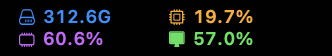
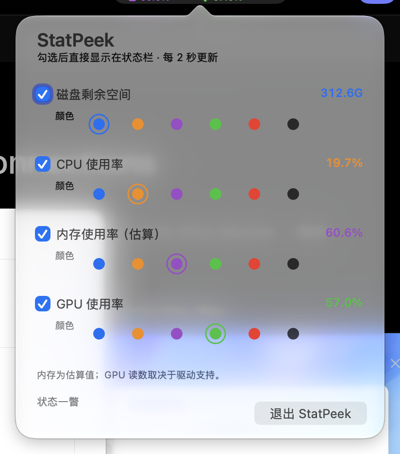

<p align="center"></p>

# StatPeek · 状态一瞥

A compact macOS menu bar monitor. Selected metrics appear in two rows of colored icons and live values. Click to choose metrics and colors directly in a popover. No main window or Dock icon.

一个无主窗口的 macOS 状态栏小工具。选中的设备信息直接以两行「小图标 + 数值」展示，点击后直接勾选显示项和配色。





## 功能

- 磁盘剩余空间、系统 CPU 使用率、内存使用率估算、GPU 使用率。
- 状态栏持续每 2 秒刷新，浮层关闭后也继续更新，仅采样选中项。
- 四项全选时，上行为磁盘和 CPU，下行为内存和 GPU。
- 每项支持六种颜色；勾选和颜色即时生效，并在重启后恢复。
- 磁盘保留一位小数，单位使用单字母，例如 `320.8G`。
- 全部取消时仍保留一个可点击图标，随时恢复显示项。
- 无第三方运行依赖，无网络请求，无 sudo 或常驻辅助进程。

## 构建与运行

需要 macOS 13+ 和支持 Swift 6 的 Xcode。本次验证环境为 Apple Silicon、Xcode 27.1。

1. 打开 `StatPeek.xcodeproj`。
2. 选择 `StatPeek` Scheme、`My Mac`。
3. 按 Run，在屏幕顶部状态栏查看指标。

项目提供本机 ad hoc 签名设置，便于源码构建。正式分发前应配置自己的签名及公证；公开仓库不等于已完成应用商店发布。

```sh
xcodebuild -project StatPeek.xcodeproj -scheme StatPeek -configuration Release -destination 'platform=macOS' test
xcodebuild -project StatPeek.xcodeproj -scheme StatPeek -configuration Release -destination 'platform=macOS' build
```

构建保持 Xcode 配置的 Derived Data 位置。用 `xcodebuild -showBuildSettings` 查看 `TARGET_BUILD_DIR`，再将完成验证的 Release `.app` 安装到 Applications。不要同时运行开发副本和安装副本。

项目已包含生成后的 Xcode 工程。只有修改 `project.yml` 时才需要 [XcodeGen](https://github.com/yonaskolb/XcodeGen)：

```sh
xcodegen generate
```

## 应用信息

| 字段 | 内容 |
| --- | --- |
| Product / Target / Scheme | StatPeek |
| Bundle identifier | com.zyapps.StatPeek |
| Version / Build | 0.1.0 / 1 |
| Category | Utilities |
| Minimum macOS | 13.0 |
| App icon | 10 个标准 macOS AppIcon 资源尺寸 |
| Dock / Main window | 无 |

最初原型的 `local.StatPeek` 偏好会迁移到当前标识；已有新标识下的选择不会被覆盖。

## 指标口径

- **磁盘**：用户主目录所在卷的可用容量，十进制单位；APFS 共享容器可能与其他工具的口径不同。
- **CPU**：Mach 系统 ticks 的两次差值，总体为 0–100%，不是单个进程的百分比。
- **内存**：活跃页 + wired 页 + compressor 页 − purgeable 页，占物理内存的比例；明确标为估算，不声称与活动监视器完全一致。
- **GPU**：驱动提供的 `IOAccelerator / PerformanceStatistics / Device Utilization %`；多 GPU 取可读设备的最高值。字段缺失时浮层显示「不可用」，状态栏显示 `—`。该字段的跨驱动稳定性没有保证。

首次 CPU 采样需要建立基线，短暂显示 `…`。macOS 13 和 Intel 实机尚未单独验收。

规格与验收标准见 [SPEC.md](docs/SPEC.md)，验证记录见 [VALIDATION.md](docs/VALIDATION.md)，图标设计及生成提示见 [icon-design.md](docs/icon-design.md)。
