# 验证记录

## 0.3.9 / Build 20 · 2026-10-26 · 无背景色点、状态栏关闭与闪烁

- 颜色井去除外层玻璃及原生背景绘制，仅显示 12 点圆点，保留 28 点点击区、焦点环和系统 Popover。已查看浅/深整页、短屏底部及第一次 Esc 后的原生窗口，见 [前后对比](evidence/status-dot-20261026/comparison.html)。合成数据，原图不加滤镜。
- 独立回放复现「监测到状态栏按下 → 失活先关闭 → 当前事件为空／被替换的按钮动作重开」。Build 18 的两项回归有 4 条失败断言；修复为原始按下意图拥有本次转换，失活不抢先隐藏，原始事件优先于转发／过期事件。非激活面板避免强制激活应用；常规刷新只在几何实际变化时更新窗口和状态项。
- Build 19 的新回归通过，但旧测试把面板样式限定为只有 borderless，因新增 nonactivatingPanel 失败；更新这一合同断言后，最终 Build 20 **62 项 XCTest 通过，0 失败**。18/19 均未安装，编号未复用。
- 最终独立窗口 **20 个浅深色/高度/滚动状态**、1,000 次展示切换与交错旧事件/重复动作通过；系统颜色 Popover **12 个流程**、分层 Esc/外部关闭 **12 个流程**通过。
- 新工具在自己的非激活窗口使用真正的 **NSStatusBarButton** 类执行 **500 次手势**，每次恰好一个原生动作，已展示时再次按下最终保持关闭，失活没有引入额外可见性切换。原生回调观察到 currentEvent 为空；另覆盖转发事件。释放事件只放入测试进程自己的队列，未进入系统输入队列、未移动用户鼠标、未激活测试应用。这仍不是用户物理状态栏完整派发链的人工验收。
- 个人固定副本 `/Users/zy/Applications/StatPeek.app` 已后台替换为 **0.3.9 (20)**，唯一运行实例来自该路径。arm64/x86_64、严格 ad hoc 签名、布尔 LSUIElement 与加密声明通过，构建/安装可执行文件 SHA-256：`55f96988187974314fa4850d346b6173a5e1b051c85f8167f35d3bf8388b577c`。
- 原 **3989 条**磁盘历史逐行未变，核对时共 **3989 条**，SQLite 完整性 ok；勾选/配色保持，未修改登录项。已清理本次旧 App、暂存、构建重复 App 和诊断原型。
- 尚未物理点击用户桌面状态栏、未在 macOS 13 / Intel 实机或真实重新登录场景验收；有限进程运行观察不代表长期稳定性保证。完整事件/布局/安装记录见 [acceptance.json](evidence/status-dot-20261026/acceptance.json)。

## 0.3.9 / Build 17 · 2026-10-26 · 仪表盘细节与个人目录交付

- 卡片减淡色底、改用中性细描边；进度条减轻轮廓；磁盘卡片收紧 8 点，历史内容统一缩进，主读数 22 点，记录与说明文字 10 点。辅助文字在实际绘制外观中解析颜色，改善深色玻璃可读性。指标语义颜色、玻璃控件、采样、数据库与登录项逻辑保留。
- 最终 Release **59 项 XCTest 通过，0 失败**。独立原生窗口浅/深色、1378/736/568/448 点高度及顶部/中段/底部共 **20 状态**，文字尺寸、无重叠、滚动刷新与固定页脚通过；1,000 次切换及交错失活、重复动作、旧事件回放通过。实际系统颜色 Popover **12 个流程**通过并检查重开画面。
- 已实际查看浅深色整页、短屏底部与原生选色窗口截图；使用生产视图/面板、隔离偏好与合成数据，不激活应用、不发送桌面鼠标键盘输入。截图不是正式用户数据库的人工点击验收。前后原始截图及完整测量见 [对比页](evidence/interface-polish-20261026/comparison.html)。
- Build 15 的首次测试发现说明与百分比标签 frame 重叠，已修正；Build 16 测试通过后，实窗发现直接给 labelColor 加透明度会提前固定浅色值，未安装。Build 17 用动态外观解析修复并重新完成测试与实窗检查。编号不复用；营销版本保持 0.3.9。
- 同一 Release 已替换至 `/Users/zy/Applications/StatPeek.app` 并后台启动，唯一实例来自固定路径。arm64/x86_64、严格 ad hoc 签名、布尔 LSUIElement/加密声明通过；构建与安装可执行文件 SHA-256 一致：`2b7460b435e6a0fea94cb2545822219682c09c88d92a1a87ca0311024c4ef6c0`。
- 原 **3969 条**历史按 ID 逐行未变，检查时当前共 **3970 条**，数据库完整性为 ok；勾选与配色保持，未修改系统登录项。已删除本次旧 App、暂存和构建重复 App，仅保留个人 Applications 固定副本。
- macOS 13 / Intel 实机、物理鼠标键盘及真实开机登录未另行验收；后台进程有限时长运行观察不代表长期稳定性保证。结构化回执见 [acceptance.json](evidence/interface-polish-20261026/acceptance.json)。

## 0.3.9 / Build 14 · 2026-10-16 · 个人目录最终交付

- 首次迁移的 0.3.8 在最终运行复核时已退出，发现真实 SIGABRT / NSInvalidArgumentException 崩溃。23:54 的报告指向 `StatusStripView.draw` 的字母绘制；迁移前 21:11 的旧副本报告也有同一调用栈。异常来自 CoreText ApplyFont 经 Cocoa 字典复制时插入 nil，不能仅据堆栈断言是哪一个属性对象复制失败。此前 0.3.8 的个人目录记录只证明当时启动和数据保留，现已标记为被此版本替代。
- 状态栏文字改为直接使用 CTFont/CGColor 属性及 CTLineDraw，避开 NSAttributedString.draw 的 AppKit 属性归一化路径。Menlo-Bold 9 点字体的测量与绘制一致，仍为两行 D/C/M/G、自选颜色；四项最坏读数占 97 × 24 点。
- 最终 Release **59 项 XCTest 通过，0 失败**；新增 448 帧原生位图绘制检查，覆盖 16 种勾选组合、7 种颜色、浅深色、1x/2x，验证实际可见像素、两行存在和彩色像素，并检查数字等宽和字母容纳尺寸。独立工具另通过 12 个真实颜色 Popover 关闭、重开及保存流程。另导出并查看浅/深色状态栏位图（合成数据，不是用户桌面截图）。
- 最终 `/Users/zy/Applications/StatPeek.app` 为 **0.3.9 (14)**，唯一进程来自该路径。安装后持续监测 **188.9 秒**，进程未退出，未发现该版本的新崩溃报告；这是有限时长的运行观察，不等同于长期零崩溃保证。全程无桌面输入或前台激活。
- arm64/x86_64、严格签名通过；有效 LSUIElement=true、ITSAppUsesNonExemptEncryption=false（布尔值）。本次测试构建和安装可执行文件 SHA-256 一致：`a5196418ad1d07e8defbc0bdc15d15af700aff93b498c1b1d14718949c8a8491`。同时保存全部应用 Swift 源文件哈希，区分源码基线提交与本次构建输入。
- 最终替换前的配色和勾选保持，976 条原磁盘记录逐行未变，观察结束时正常记录共 977 条。系统 Applications 旧副本、本次旧版备份、暂存与构建重复 App 均已移除，只保留个人目录固定副本。后续沿用 [AGENTS.md](../AGENTS.md) 的 Release 替换与运行流程。
- macOS 13 / Intel 实机、真实重新登录启动未单独验收；系统后台任务登记路径查询没有在限定时间内返回完整结果，未将其计为已通过。

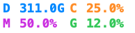
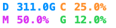

结构化证据及崩溃摘要见 [personal-release-0.3.9-acceptance.json](personal-release-0.3.9-acceptance.json)。以下为历史版本证据。

## 2026-10-15 · Release 迁移到个人 Applications

- 按用户要求重新构建当前 **0.3.8 (13)** Release，保持 Xcode 配置的 Derived Data；完整 **57 项 XCTest 通过，0 失败**。应用源码未更改，版本不递增。
- 固定交付位置改为 `/Users/zy/Applications/StatPeek.app`。完成暂存、签名与元数据检查后替换旧副本，以 `open -g` 后台启动；核对唯一进程来自该个人目录。原 `/Applications/StatPeek.app`、本次旧版备份、暂存和构建重复 App 均已移除。
- arm64/x86_64，严格签名校验通过；有效 LSUIElement=true、ITSAppUsesNonExemptEncryption=false（布尔值）。本次 Release 构建与安装可执行文件 SHA-256 一致：`b40914b85983c815367883e38d567e56eac8bfec633dc9043c6ec76c68d65997`。
- 原选择与配色保持，973 条已有磁盘记录按 ID 逐行未变；启动后正常新增一条，共 974 条。全程没有发送桌面输入或操作用户鼠标、键盘。
- 后续每次更新均执行「验证 Release → 替换个人 Applications 中的旧版 → 后台运行新版 → 核对唯一进程及数据保留 → 清理已确认的重复 App」，已写入工程 [AGENTS.md](../AGENTS.md)。历史版本中 `/Applications` 的记录保留为当时的交付证据。
- 目录迁移与应用运行已验证；系统后台任务登记路径查询在限定时间内未完成，未据此确认登录项路径，也未重启电脑进行真实登录启动验收。

结构化证据见 [personal-install-acceptance.json](personal-install-acceptance.json)。以下为历史版本证据。

## 0.3.8 / Build 13 · 2026-10-14

- 用户确认问题主要是「已展开时点击关不掉」。在生产鼠标监测入口回放一条点击位置仍在状态栏、但处理时鼠标已移开的事件，旧版把它当成外部点击先关闭，随后的按钮动作又打开；失败回归 1 项、1 个断言。改用事件自己的屏幕坐标后该测试通过。
- 再回放「鼠标按下→失活先关闭→按钮动作」及同一鼠标事件重复动作，旧逻辑 2 项测试产生 3 个失败断言。修复按钮动作把原始 NSEvent 传给展示控制器，以事件时间戳和实际显隐区间决定点击开始时的状态；提前关闭后的同一点击仍以关闭结束。同一事件只处理一次，较旧动作忽略，新点击没有防抖等待。上一展示会话的延迟鼠标事件不能关闭新浮层。
- 最终 Release **57 项 XCTest 通过，0 失败**，含 12 项展示专项。新增事件坐标变化、失活前后次序、重复动作、旧事件/动作和新点击立即打开回归；原生颜色控件测试也在重开选色后交错失活，再验证按钮关闭不会重开。分层 Esc、颜色保存、采样、记录及布局回归保留。
- 独立原生窗口完成 **1,000 次切换**，额外交错 **250 次失活、1,000 次重复动作、1,000 条旧鼠标事件**。每次状态符合奇偶性，偶数次关闭后运行循环仍保持隐藏。浅/深色、四档可用高度及滚动位置共 **20 个截图状态**全部通过；已查看最短屏底部，固定页脚及滚动保持。
- 真实系统颜色 Popover 另通过 **12 个独立流程**并截图：打开时主浮层保持，四项选色只写目标指标；重开选色阶段先失活关闭，再处理及重复处理原点击，主/子窗口与 Popover 内部状态都保持关闭。
- 事件数据在进程内构造并直接交给与生产相同的处理入口；没有向系统事件队列投递，也没有模拟物理菜单栏点击。测试不激活应用、不成为 key/main、不接收鼠标事件，使用隔离偏好、合成指标及临时记录库，不操作用户鼠标和键盘。这里是原生窗口与事件顺序回放证据，不是用户桌面现场轨迹。
- `/Applications/StatPeek.app` 已后台更新为 **0.3.8 (13)**，唯一进程来自固定路径；arm64/x86_64、严格签名通过，有效 LSUIElement=true、ITSAppUsesNonExemptEncryption=false（布尔值）。测试构建与安装可执行文件 SHA-256 一致：`369b2ed2d8d34d38aa2defde4ecaaa713282ecc5eb2614985b40e2b6abd52791`。
- 原配色和四项选择保留，621 条原磁盘记录按 ID 逐行未变；已移除本次暂存、旧安装备份和构建重复 App。macOS 13 / Intel 实机未单独运行。

独立测试窗口截图（合成数据）：

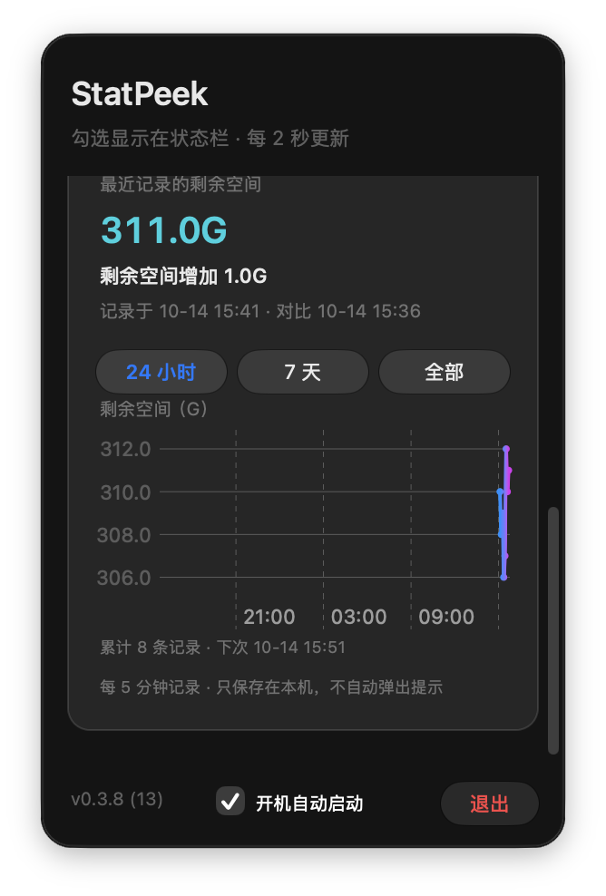

结构化证据见 [status-toggle-acceptance.json](status-toggle-acceptance.json)。以下为历史版本证据。

## 0.3.7 / Build 12 · 2026-10-14

- 新增真实原生颜色控件失败回归：旧版收到主面板 cancelOperation 时，第一次就关闭主浮层，四项产生 8 个失败断言。另用颜色子窗口 firstResponder.doCommand 回放系统取消命令，观察到子窗口隐藏但 NSPopover.isShown 与颜色井激活状态残留；该试探不计作通过验收。
- 修复主面板取消命令为分层关闭；对属于浮层的窗口，在应用本地 keyDown 监听中提前接管 Escape，避免原生子窗口留下未结束的展示状态。第一次只同步关闭颜色选择器并取消颜色井，保留主浮层会话及监听；第二次关闭主浮层。外部点击及状态栏关闭保持一次收回两层。不会吞掉其他窗口的 Escape。
- 最终 Release **52 项 XCTest 通过，0 失败**。其中 7 项展示专项回归覆盖四项真实 NSColorWell / NSPopover、主面板取消路由、颜色子窗口 Esc 处理入口、外部关闭、重开后原生选色持久化、关闭回调次数、无延迟重开及非所属窗口隔离。
- 独立原生窗口通过 **12 个流程，保存 20 个截图状态**：四项各三种关闭路径；每个两次 Escape 流程额外截图第一次之后仅保留的主浮层。颜色经 NSColorPanel 的系统模型提交给激活颜色井，不直接调用应用回调。选色、普通更新、关闭和重开均不串项、不意外改写已保存值。
- 全程不操作鼠标或键盘、不发送输入事件、不切换前台应用；测试窗口不成为 key/main，不接收鼠标事件。测试采用唯一隔离偏好及合成指标，不打开正式磁盘库。Esc 与外部点击由生产 responder/处理入口直接回放，未注入物理按键，也不将此描述为用户实际桌面的按键验收。
- 已后台更新并启动 `/Applications/StatPeek.app` **0.3.7 (12)**，仅一个固定路径进程；arm64/x86_64、严格签名通过、有效 LSUIElement=true、ITSAppUsesNonExemptEncryption=false（布尔值）。构建与安装可执行文件 SHA-256 一致：`a79bd3ada3bbfcdc901b7870de5e6aac8df43c779f451cb9f054c4899906a6c7`。
- 原配色与四项选择保持，617 条原磁盘记录按 ID 逐行不变；已移除本次暂存、旧安装备份与构建重复 App。macOS 13 / Intel 实机未单独运行。

下图为独立测试的颜色选择器打开状态，以及第一次 Esc 后保留的主浮层（合成数据）：

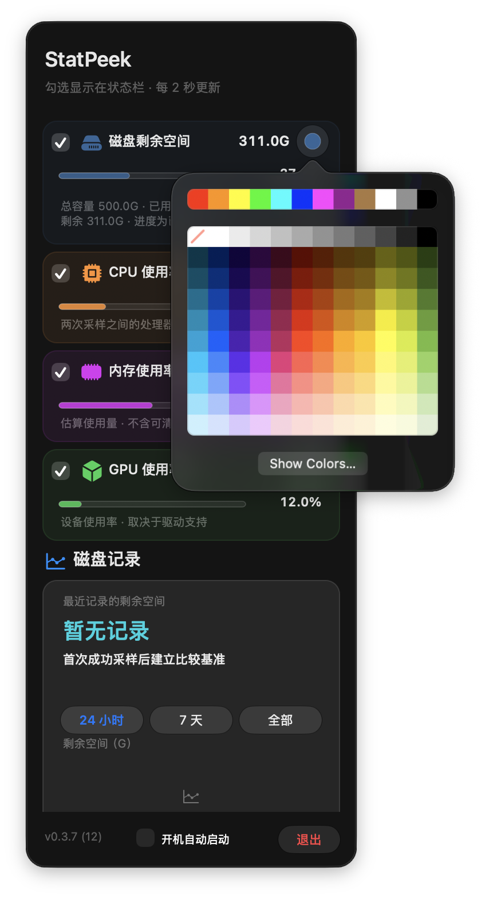
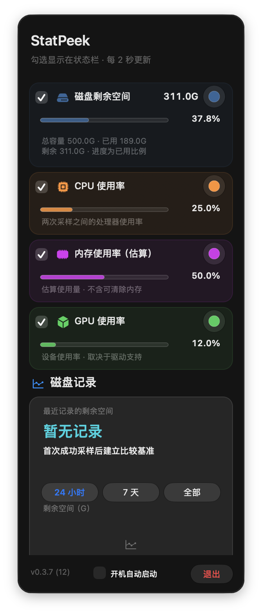

结构化证据见 [layered-dismissal-acceptance.json](layered-dismissal-acceptance.json)。以下为历史版本证据。

## 0.3.6 / Build 11 · 2026-10-14

- 真实独立颜色控件回放复现旧行为：关闭主面板后，原生颜色 NSPopover.isShown 仍为 true，重开同一控件后没有可见颜色窗口，回归程序退出 1。仅隐藏/关闭子 NSWindow 不能完成 Popover 自身生命周期；保留动画的 close 也会被紧接着隐藏父窗口打断。
- 修复为通过公开 nextResponder 链取得 NSPopover，在收起主面板之前暂时禁止其关闭动画并同步 close，确认 isShown=false 后恢复动画设置，再取消颜色井激活及隐藏父面板。无私有选择器、KVC 或系统输入注入。
- 最终 Release **50 项 XCTest 通过，0 失败**。新增真实 NSColorWell / NSPopover / NSColorPanel 集成回归：四项各三阶段，选色关闭、未选色取消关闭、重开再选色；同时检查刷新时两层保持显示、关闭时两层和颜色井状态清空、颜色只写入对应项且从独立偏好恢复。
- 独立原生工具额外通过 **12 个窗口场景**并保存真实颜色 Popover 截图。每次使用控件 performClick 打开系统颜色选择器，使用 NSColorPanel.shared.color 通过 AppKit 激活颜色井通路提交 #336699 / #CC3355，未直接调用应用颜色回调。主面板一直显示，关闭后子窗口与 isShown 均为 false，重开可再次提交。
- 测试未移动鼠标、发送桌面鼠标或键盘事件、切换前台应用；所有控件动作、颜色模型提交及状态检查局限于独立进程。测试窗口不接收点击且不成为 key/main。使用唯一 UserDefaults suite 与合成读数，不打开正式磁盘库；没有物理点击色块，截图明确为测试数据。
- 早期试探中，当前 AppKit 的色块 accessibilityPerformPress 触发系统适配器异常；该尝试不计作有效选色证据。最终框架改用公开系统颜色模型通路，既能观察真实保存回调，也无需创建输入事件。
- 最终 `/Applications/StatPeek.app` 为 **0.3.6 (11)**，唯一进程来自固定路径；arm64/x86_64，严格签名通过；有效 LSUIElement=true、ITSAppUsesNonExemptEncryption=false 为布尔值。构建与安装可执行文件 SHA-256 一致：`35c32dec0b66389e801531ac407db8d4dfb3e9109997c388748f79915f3c7c49`。
- 用户配色及选择保留，610 条原磁盘记录逐行未变，安装时共 610 条。替换及后台启动不操作桌面输入，已移除本次旧安装备份、暂存及构建重复 App。macOS 13 / Intel 实机未单独运行。

下图为独立窗口中的首次选色及关闭重开后的再次选色（合成数据）：

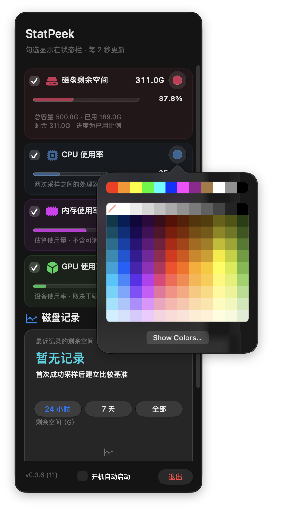
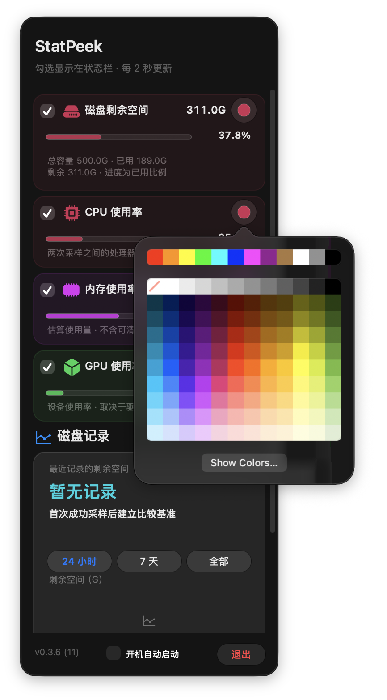

结构化证据见 [color-lifecycle-acceptance.json](color-lifecycle-acceptance.json)。以下为历史版本证据。

## 0.3.5 / Build 10 · 2026-10-14

- 最终 Release **49 项 XCTest 通过，0 失败**。新增真实 NSPanel 上的状态栏按下/失活/按钮动作顺序、100 次快速开关奇偶性及延迟重开、颜色窗口保留、外部关闭/重复关闭、cancelOperation 和多屏边界回归。其余布局、采样、存储和颜色测试保留，版本标签更新为两位 build 检查宽度。
- 最小原生回放模拟了 semi-transient 先关闭、按钮动作随后执行的事件顺序，输出 first_click_shown=true、second_click_remains_open=true，退出 1。这证明该顺序会触发原 toggle 按 isShown 再打开的模式；并非对用户真实桌面事件的捕获，不声称已取得现场轨迹。
- 试验 hasFullSizeContent 可以将背景延伸到箭头，但会改变内容安全区域，出现位置偏移。本次采用用户允许的无箭头方案：borderless NSPanel 上的单层 NSGlassEffectView，未使用私有 API 隐藏系统箭头。
- 状态栏动作改为鼠标按下即切换，展示控制器直接 orderOut 关闭，禁用窗口动画。鼠标监测与失活处理排除当前状态栏点击，应用内颜色窗口保持父面板；关闭会清理监听、颜色窗口和图标动画。位置随锚点更新并限制在可用屏幕内。
- 独立工具使用与生产相同的展示控制器及完整设置视图，浅/深色分别 100 次，共 **200 次快速开关**，偶数次后保持隐藏，运行循环后未延迟重开。**20 个实际面板截图状态**保留自适应、滚动和固定页脚，已查看完整和最短屏截图，背景无箭头接缝。
- 全程未发送鼠标/键盘事件；测试面板不接收点击、不成为 key/main，截图时测试进程未成为前台应用。隔离窗口关闭环境事件监听，以直接路由调用检查事件顺序；实际菜单栏物理点击及颜色 Popover 点击未自动化，留待自然使用确认。合成数据只写临时数据库。
- 最终 `/Applications/StatPeek.app` 为 **0.3.5 (10)**，唯一进程来自固定安装路径；arm64/x86_64，严格签名通过；有效 LSUIElement=true、ITSAppUsesNonExemptEncryption=false 为布尔值。构建、验证及安装可执行文件 SHA-256 一致：`da405c59d34a10d161b6edf8a13b0fec2fcc2b7cbd356d6640247e91baf22242`。
- 更新前的选择和配色保持，603 条原磁盘记录逐行未变，安装时 603 条。最终替换通过进程终止及后台启动完成，没有操作桌面输入；构建重复 App、暂存与旧备份已移除。macOS 13 / Intel 实机未单独运行。

下面是同一展示控制器的独立测试面板（合成数据，非本机指标）：

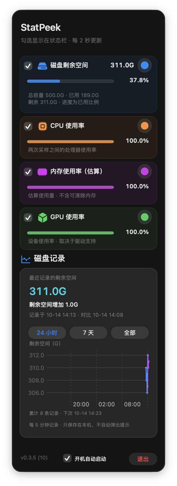
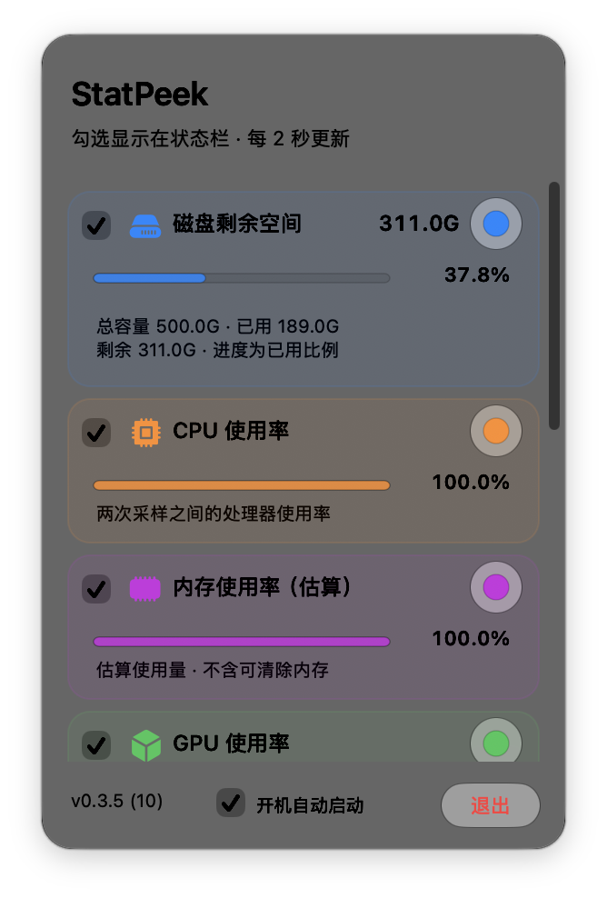
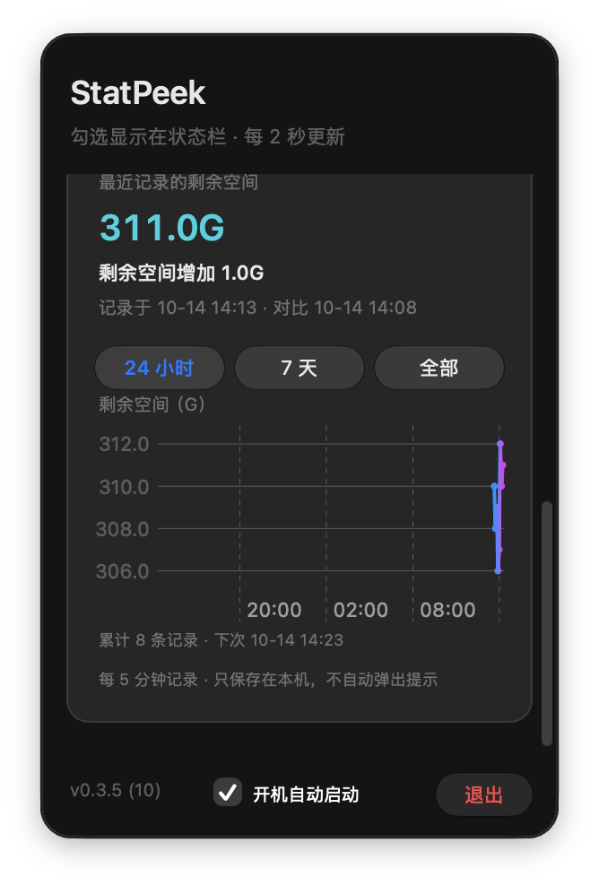

结构化证据见 [presentation-acceptance.json](presentation-acceptance.json)。以下为历史版本证据。

## 0.3.4 / Build 9 · 2026-10-13

- 最终 Release **45 项 XCTest 通过，0 失败**，覆盖窗口挂载/缩放后的滚动区边界、刷新保持偏移、固定页脚、正常/采样中/不可用/空历史文字尺寸、同层文本不重叠、指标图标居中及 4 点间距。
- 真实独立窗口发现并修复了仅查隐藏视图未覆盖的高度重复调整：玻璃内容层晚调整时，滚动区的 height autoresizing 重复应用尺寸差，造成空白或压住标题。修复为高度显式布局、仅宽度 autoresizing；窗口布局完成后再断言高度与边界。
- 独立原生测试窗口浅/深色共 **20 个状态**：可用高度 1378、736、568、448 点；后三档分别检查顶部、中段和底部。完整内容高 870 点，视口 744 点，不滚动；小屏视口分别为 610、442、322 点，可滚到底部，刷新不跳动。固定标题和页脚无覆盖，所测文案没有宽/高截断或同层重叠。
- 图标与指标文字共用中心线并收紧至 4 点间隔，指标符号改为 14 点；历史标题图标间距也收紧至 4 点。实际绘制截图已查看，浅/深色及最短屏幕边界检查通过。
- 全程没有发送鼠标或键盘事件。独立窗口不接收点击，不成为 key/main；每个截图状态核验测试进程未成为前台应用。通过程序操作自己的 scroll view，并只截取自己的窗口。临时偏好与临时 SQLite 中的合成读数不进入实际用户数据库。
- XCTest 进程内调用系统截屏失败，因此自动测试保留尺寸/布局检查，实际玻璃绘制由独立原生工具配合外部窗口截屏完成；未将失败尝试或不完整的隐藏玻璃截图当作最终可见证据。
- `/Applications/StatPeek.app` 已更新为 **0.3.4 (9)**；唯一进程来自固定路径，双架构，严格签名验证通过；有效 LSUIElement=true 和 ITSAppUsesNonExemptEncryption=false 为布尔值。构建与安装可执行文件 SHA-256 一致：`35b9611c55c936a1734fdc30e6dc92d3330093817c787056bf83e34e9d1e0059`。
- 更新前的选择和颜色保留，403 条原真实磁盘记录逐行未变，安装时累计 403 条；通过进程终止及后台启动替换，未操作桌面输入。构建重复 App 与旧安装备份已移除。
- 当前修订未通过桌面自动化打开实际菜单栏 Popover；独立窗口验证的是同一套原生内容视图及布局，不替代实际 NSPopover 宿主的最终可见验收。macOS 13 与 Intel 实机未单独运行。

以下为独立测试窗口（合成数据，非本机指标截图；勾选控件呈系统非激活态）：

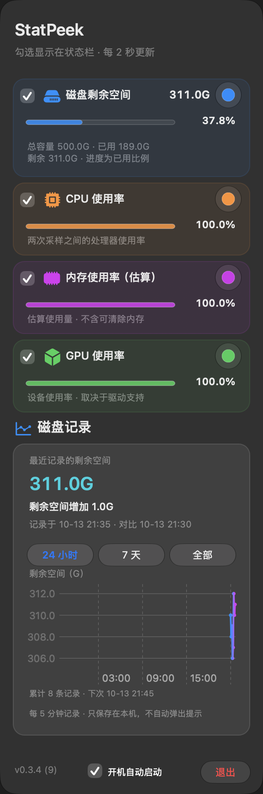
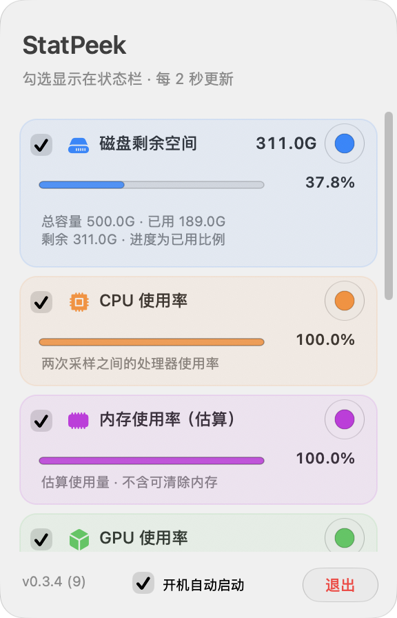
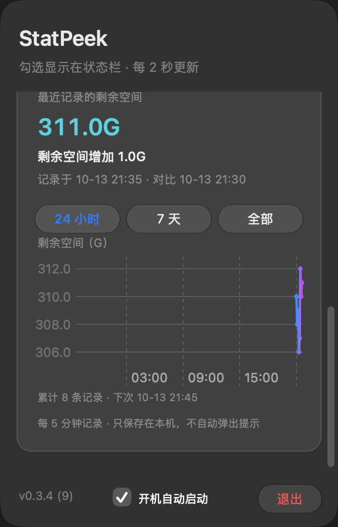

结构化证据见 [independent-layout-acceptance.json](independent-layout-acceptance.json)。以下为历史版本证据。

## 0.3.3 / Build 8 · 2026-10-13

- 最终自适应布局完整 Release 套件 **44 项 XCTest 通过，0 失败**。独立控件验证包含颜色初始化不写入、CPU/GPU 目标隔离、正在编辑的颜色不被实时刷新覆盖、未选中显示灰色且原颜色保留；新增高屏完整容纳、短屏滚动、恢复高屏重置偏移及固定页脚可达性检查。
- 浮层宽 288 点（减少 24.2%）；高度由内容计算，当前自然高度约 870 点，受状态栏所在屏幕可用高度减去 32 点限制，仅放不下时纵向滚动。历史内容从 420 点缩至 304 点，剩余量为 20 点青色，变化文案 11 点。原生浅/深历史测试在独立隐藏窗口实际绘制曲线像素，不移动鼠标或输入键盘。
- 最终磁盘/CPU/内存/GPU 使用填充 SF Symbol，GPU 为 cube.fill，表达 3D 图形渲染，不宣称专用 GPU 符号。装饰图标不带玻璃底座；颜色入口为圆形玻璃，退出与历史范围为胶囊玻璃，主浮层为系统玻璃。开机启动保持无背景，退出为 24 点高红色文字，无图标。
- 原生出现动画为 macOS 14+ 一次性 Bounce.byLayer，普通数据更新不重播；macOS 13 静态，无自制动画。隐藏、未选中和减少动态效果停止，由源码核验，未改变用户全局系统偏好。避免跨滚动边界提升玻璃层，保留滚动裁切以保护标题。
- 较早同版本迭代曾做真实桌面交互：CPU #0042AA、GPU #FFF76B 分别通过系统颜色 Popover 修改，其他项不变，主浮层不消失，关闭子浮层后保留主浮层；取消 CPU 显示灰色静态，真实退出/启动保留选择和颜色。三个历史范围均可操作，读数持续变化；页脚三项中心一致，状态栏仍为 107 × 24 点。
- **用户提出不控制鼠标/键盘后，后续没有进行桌面输入自动化。** 去除装饰图标底座及紧凑自适应布局后的最终版本，依据隔离自动测试、源码和安装检查交付；最终外观与出现动画待用户自然使用确认。较早交互证据不作为最终布局的可见验收，旧截图也不作为当前 README 预览。
- 最终 `/Applications/StatPeek.app` 为 **0.3.3 (8)**，唯一运行进程来自该路径；arm64/x86_64，严格签名验证通过；有效 LSUIElement=true、ITSAppUsesNonExemptEncryption=false 均为布尔值。最终构建与安装可执行文件 SHA-256 一致：`073e1760a396d557e374349d73a424e40a5b6fda69e2794362352867ba5769cb`。
- 四项全选及蓝/橙/紫/绿配色保持，385 条原磁盘记录逐行未变，正常五分钟记录继续至安装时 399 条；已启用启动项在较早迭代读取并保留，最后修订没有改变注册逻辑。最终替换通过终止应用进程及后台启动完成，未操作桌面鼠标/键盘；本次临时和构建重复 App 已删除。
- macOS 13 与 Intel 实机未单独验收，未为此重启电脑观察登录启动。

结构化证据见 [narrow-glass-acceptance.json](narrow-glass-acceptance.json)。以下为历史版本证据。

## 0.3.2 / Build 7 · 2026-10-13

- 最终完整 Release 套件 **43 项 XCTest 通过，0 失败**。动画与颜色浮层修复均包含在最终构建；此前仅动画的构建不用于安装。
- Apple SF Symbols 目录中 gpu/graphicscard 无对应名称，原 cpu.fill 与 CPU 相似。GPU 改为 square.3.layers.3d，用三层图形表达图形渲染；这是本应用的语义选择，不宣称为 Apple 专用 GPU 符号。四项保持统一 SF 风格，未生成额外位图。
- Apple 导出模板确认 GPU 有三组运动图层，磁盘/CPU/内存各一组。改用系统原生 Breathe.plain.byLayer（速度 0.65），移除 Core Animation 透明度替代。九个原生截图分别比较四项独立图标区域，均观察到缩放动画；另保留六秒实际安装动画录像在本机工作目录。macOS 13/14 保持静态，macOS 15+ 使用原生效果，Symbols 弱链接保留最低 macOS 13。
- 浮层改为 semi-transient，并在应用失去激活状态时关闭。真实打开 CPU 颜色面板后浮层持续显示且读数更新；切到 GPU 配色保留浮层，初始化不覆盖 CPU 配色，关闭面板后浮层仍可操作。Finder 激活、状态栏再次点击及 Escape 关闭验证通过。
- CPU #336699、GPU #33AA77 与取消 GPU 显示均经过真实退出/启动恢复，随后恢复测试前的四项全选和蓝/橙/紫/绿配色；已启用登录启动项保留。376 条原历史按 ID 逐行保持不变，正常五分钟记录继续至安装时 378 条。首次 GUI 流程在末尾重启检查时受外部焦点中断，重新完成验证，未将中断尝试标为完整通过。
- 安装副本再次实测颜色面板与浮层同时显示、面板关闭后保留浮层及真实退出/启动保存。最终 `/Applications/StatPeek.app` 为 **0.3.2 (7)**，唯一运行进程来自该路径；arm64/x86_64，严格签名检查通过。有效 LSUIElement=true、ITSAppUsesNonExemptEncryption=false 为布尔值。
- 构建、验证和安装的可执行文件 SHA-256 一致：`cf54cfd5a2e710dae9c5060324c942e288f069f5f1831c2e99e64d10006be4fe`。本次已确认的暂存、替换备份与构建重复 App 已移除；真实安装和系统颜色面板截图已更新。减少动态效果与隐藏动画停止由源码核验，未改全局系统偏好；macOS 13/14 与 Intel 实机没有单独运行验证。

结构化证据见 [native-symbols-acceptance.json](native-symbols-acceptance.json)。以下为历史版本证据。

## 0.3.1 / Build 6 · 2026-10-13

- 完整 Release 套件 **43 项 XCTest 通过，0 失败**；源、测试与最终安装来自同一次构建。
- 真实浮层中四项百分比仅在进度条右侧各出现一次；磁盘标题保留剩余 G 数。磁盘卡片 108 点、其他卡片 80 点，间隔 6 点；上下滚动确认启动项位于历史下方，版本/退出固定。
- 六个模块的原生彩色 SF Symbol 显示正确。指标图标跟随所选颜色；用八个原生截图对磁盘图标的独立像素区域进行比较，观察到轻微呼吸动画。状态栏继续 D/C/M/G，宽度仍为 107 × 24 点。
- 源码检查确认可见区域、浮层关闭及减少动态效果控制动画开关；未改变用户的减少动态效果设置进行验收。macOS 14+ 使用原生 PulseSymbolEffect，macOS 13 使用透明度动画；Symbols 框架在双架构二进制中弱链接，未提升最低系统要求。macOS 13 与 Intel 实机没有单独运行验证。
- 四项逐一取消/恢复，CPU 取消后真实退出/启动仍取消，随后恢复；滚动到底部约 6 秒保持 1.0，状态栏连续更新。原配色、已启用启动项及 362 条原磁盘记录逐行保持不变，五分钟记录继续至安装时 366 条。没有伪造曲线数据。
- 首次安装核对发现磁盘选择与测试前不一致，回退安装；通过真实复选框恢复原选择后重新安装成功。最终安装再退出/启动，四项全选、配色和已启用登录项均保留。
- 最终 `/Applications/StatPeek.app` 为 **0.3.1 (6)**，唯一进程来自此路径；arm64/x86_64，严格签名校验通过；有效 LSUIElement=true 和 ITSAppUsesNonExemptEncryption=false 均为布尔值。构建、验证和安装的可执行文件 SHA-256 一致：`337d63cdc47e32e9867fe145f5d380ecb7e0aa03c6b1b356305bdd9eb4b8d7f3`。
- 本次确认的验证副本、旧安装备份及构建目录重复应用已移除。真实安装区域截图已更新，浅色验证截图留在本机工作记录中；以下旧版证据保留为历史。

结构化证据见 [compact-symbols-acceptance.json](compact-symbols-acceptance.json)。

## 0.3.0 / Build 5 · 2026-10-13

- 最终完整 Release 套件 **43 项 XCTest 通过，0 失败**，包括既有采样、全部选择、登录项、SQLite 和五分钟边界；新增容量边界、自定义 sRGB 保存/迁移/隔离、系统面板目标切换与初始化不写入、未选中卡片预览和刷新保持滚动文档，以及极端配色进度的真实绘图检查。
- 白色浅背景与黑色深背景测试实际绘制轨道及 0/50/100% 填充，验证已知 0 与未知/NaN 不同。历史曲线在独立 Aqua/DarkAqua 原生测试窗口中绘制真实像素，附件保留在 XCTest 产物；合成数据仅存在临时测试库，不作为 README 产品截图。全部范围跨年份时轴标签包含年份，24 小时使用短时间标签。
- 原生辅助功能实测四项分别取消/恢复立即更新状态栏；全部取消经过真实退出/启动，仍能打开设置并实时预览四项。底部滚动位置连续约 6 秒保持 1.0，状态栏和卡片读数持续变化。
- 行尾小圆点打开真实 macOS Colors 面板。CPU `#336699`、GPU `#AA4477` 经系统输入、目标切换及真实退出/启动保留；面板初始化不改配色，浮层关闭后仍保存正确目标。最终恢复用户测试前的四项全选与蓝/橙/紫/绿配色。
- 原用户已启用的登录启动项在验证和最终安装后均读取为 enabled；本次没有注册/注销它，也没有重启系统。
- 338 条已有真实磁盘记录按原 ID 逐行比较保持不变，独立五分钟采样继续；最终安装检查已有 339 条。测试与重建产生的真实容量变化保留，未修改数据库以制造趋势。
- 实际安装截图已更新 `assets/statusbar.png`、`assets/popover.png`、`assets/disk-history.png`；均为应用原生区域截图，未重绘，浮层截图仅截取干净内部区域。`assets/color-panel.png` 是本次真实系统面板。浅/深仪表盘曾观察实际界面；最终深色历史文字和极端配色进度由隔离原生渲染验证。
- `/Applications/StatPeek.app` 为最终 **0.3.0 (5)**，唯一运行实例来自此路径。状态项仍为 **107 × 24 点**，双架构 arm64/x86_64，`codesign --verify --deep --strict` 通过；有效 LSUIElement=true、ITSAppUsesNonExemptEncryption=false 为布尔值。
- 最终构建与安装可执行文件 SHA-256 一致：`43c6767a28baf1e31383baef2cba40fe52f9147797972ef3ea45b3f171a2e8c1`。仅移除本次确认的临时、替换备份与构建重复应用，保留源、偏好和真实用户数据。Derived Data 继续使用 Xcode 实际配置的位置。

结构化证据见 [scrolling-dashboard-acceptance.json](scrolling-dashboard-acceptance.json)。以下为历史版本证据，不代替本次检查。

## 0.2.1 / Build 4 · 历史记录

日期：2026-10-12（Asia/Shanghai）。本机 Apple Silicon、Xcode 27.1、Swift 6.4。当时版本 **0.2.1 / Build 4**，最低 macOS 13。

## 自动检查

- 0.2.0 的完整 Release 套件 **37 项 XCTest 通过，0 失败**。包含既有 23 项指标计算、紧凑布局、选择/配色保存和登录项测试，以及 10 项磁盘历史测试、4 项原生记录面板测试。
- 磁盘历史覆盖：299 秒不读、300 秒记录；SQLite 关闭再打开与剩余到期时间；休眠后只采当下真实值；读取失败保留历史并延迟重试；增加/减少与不足 0.1G；换卷、时钟回退；全量保存和按范围读取；无效记录、损坏数据库保护；绘图保留端点、极值与断点。
- 原生面板使用独立临时数据库验证基准/增加/减少、错误保留最后值、空记录不伪造零，以及真实绘图像素。测试用曲线数据只存在临时测试数据库，未注入实际用户记录。
- 本次 0.2.1 的平滑渐变曲线通过 **4 项记录面板测试，0 失败**，最终 Release 构建成功；测试实际绘制曲线。本次调整只涉及绘图，采样和存储实现不变。

## 本机界面

最终安装副本真实截图：`assets/statusbar.png`、`assets/popover.png`、`assets/disk-history.png`。

- 状态栏改用 **D/C/M/G + 数值**，上下两行。辅助功能测得四项宽度 **107 × 24 点**。数字保持 9 点等宽；单元测试覆盖全部 16 种选择与最坏读数边界。
- 浮层关闭及持续打开时分别连续约 8 秒采样；CPU、内存和 GPU 读数更新，浮层内容同步变化。记录见 [live-refresh-acceptance.json](live-refresh-acceptance.json)。
- 四项分别取消和恢复，立即改变状态栏；混合选择和全部取消均经过真实退出/启动；CPU 红色、GPU 紫色的选择在重启后保留。六段色条逐项选中成功；最终恢复测试前的全选及蓝/橙/紫/绿配色。
- 选中标记为色条中央 **18 点小圆玻璃**，圆内有勾号；macOS 26+ 使用原生 NSGlassEffectView，六种颜色保持连续长胶囊。截屏确认小圆形状及勾号可见。
- 当前用户的「开机自动启动」原本已开启，安装后的复选框和系统服务仍显示已启用，未为本次测试改变该偏好。
- 无主窗口、无 Dock 图标，只有一个状态栏项。磁盘为一位小数、单字母单位。

交互证据见 [metrics-acceptance.json](metrics-acceptance.json)。这是多次原生操作的成功检查记录；调试过程中外部焦点变化关闭过 transient 浮层，相应中断尝试保留在本机工作日志，不当作一轮完整交互通过。

## 磁盘记录

- 使用正式 5 分钟周期和真实本机剩余量，初始四条分别在 12:05:06、12:10:06、12:15:06、12:20:06 写入，连续间隔 **300.376、300.470、300.056 秒**，未修改正式定时器或伪造记录。
- 记录页显示真实剩余量、较前次增加或减少的一位小数 G 数、上次和本次采样时间、累计记录、下次采样时间，以及 24 小时/7 天/全部曲线。
- 最终记录页截图使用实际用户数据库中的真实记录。读数曲线反映真实剩余空间变化，测试/构建期间产生的磁盘变化同样保留。
- 实际退出/启动后，历史记录和记录页选择恢复；未到五分钟边界时重启不新增重复记录。
- 本机 SQLite 持续保留全量记录，不自动清除。取消状态栏磁盘显示不会停掉历史记录；这一点由独立记录控制器实现，虚拟时钟测试验证采样边界。休眠期间无伪造数据。

证据见 [disk-history-acceptance.json](disk-history-acceptance.json)。安装副本在 12:25:06 继续写入第 5 条真实记录，间隔 300.076 秒；最终小圆标记的六段交互、原配色与启动项保留记录见 [installed-acceptance.json](installed-acceptance.json)。

## 0.2.1 平滑渐变线条

- 历史曲线采用单调三次插值，真实采样点保留，换卷与时钟回退仍分段；只修改显示，不修改采样记录。
- 渐变用于线条本身，从蓝经靛蓝过渡至紫；起止位置按真实记录的时间跨度映射到绘图区，使 24 小时、7 天和全部范围均能呈现完整渐变。未添加曲线下方填充。
- 最终安装副本已查看真实历史曲线，截图更新为 `assets/disk-history.png`。安装后复选框、原配色、已启用的开机启动项和历史数据保留，只有一个运行实例。
- 证据见 [smooth-gradient-acceptance.json](smooth-gradient-acceptance.json)。

## 登录启动既有验证

0.1.1 已在固定 Applications 路径实测注册为 `enabled`、取消为 `notRegistered`，两者均经过应用退出/启动；记录保留于 [login-item-acceptance.json](login-item-acceptance.json)。本次启动项实现不变，自动测试仍通过，保留用户当前已启用设置。

未为验收重启电脑或注销用户，因此系统注册与应用重启恢复的证据不等于实际开机登录观察。

## 安装

- `/Applications/StatPeek.app` 已更新至 0.2.1 / Build 4 并启动。进程来自固定安装路径，只有一个实例。
- 最终构建、验证副本与安装副本可执行文件 SHA-256 一致：`c2ce357df77a4397537fac982dce2d0fc7e780d8b7b9404ca7099f39ad4b92e7`。
- `codesign --verify --deep --strict` 通过；本机 ad hoc 签名，包含 arm64、x86_64。
- 有效 plist：Bundle ID `com.zyapps.StatPeek`，Utilities 分类；`LSUIElement=true`、`ITSAppUsesNonExemptEncryption=false` 为布尔值。
- 已移除本次临时验证应用、替换前备份和构建目录中的重复应用，保留一个固定名安装副本，源代码与用户数据库不删除。
- 使用实际 Xcode 配置的 Derived Data。本机工作日志、测试产物及 MCP 配置不提交公开仓库。

## 适用范围

本机实际验证如上。内存为估算，GPU 取决于驱动字段；macOS 13 与 Intel 实机未单独验收。未完成 Developer ID、公证或 App Store 发布；GitHub 公开的是源码。
